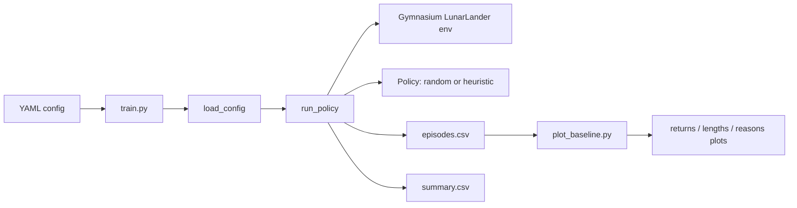
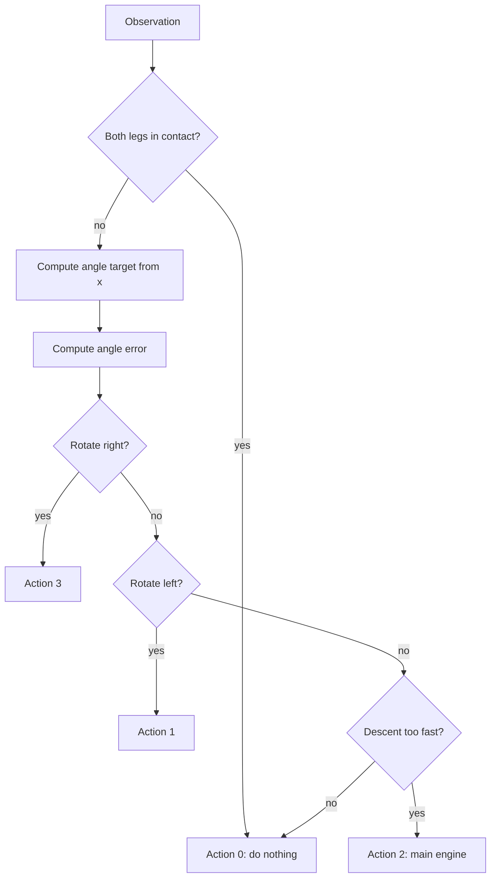

# Start Trek Baseline Report

## Overview
This report documents the current state of the **Start Trek** project, a LunarLander reinforcement-learning scaffold centered on reproducible baseline experimentation rather than a learned agent.[cite:1][cite:3] The repository already includes command-line entry points for running baseline jobs, evaluating saved configurations, and plotting episode-level metrics, while the README explicitly states that the full learning agent, ablations, and final report are still pending.[cite:1]

The implementation therefore represents an instrumentation-first milestone: it establishes the environment wrapper, deterministic episode seeding, CSV summaries, and simple policy baselines that future reinforcement-learning agents can be measured against.[cite:2][cite:4] This is a sensible early setup because it makes later comparisons easier and forces the project to define how performance will be logged before model training becomes more complex.[cite:1][cite:2]

## Project Setup
The package targets Python 3.10 and depends on Gymnasium with Box2D, NumPy, pandas, PyYAML, and Matplotlib, which together cover environment simulation, numeric processing, configuration management, and baseline plotting.[cite:3] The README instructs installation through `pip install -r requirements.txt`, while the project metadata identifies the package as `start-trek` and describes it as a Lunar Lander reinforcement-learning scaffold.[cite:1][cite:3]

The execution flow is split into small scripts. `train.py` loads a YAML configuration, optionally overrides the output directory, runs a baseline policy through `run_policy`, and reports the mean return over all recorded episodes.[cite:4] The README also lists `eval.py` for evaluation and `plot_baseline.py` for visualization of episode returns, episode lengths, and termination-reason counts from `episodes.csv` outputs.[cite:1][cite:5]

### Pipeline Diagram

This structure is compact and reproducible. Each run writes `config.json`, `episodes.csv`, and `summary.csv`, plus videos when recording is enabled, which makes every experiment traceable to a specific configuration and seed range.[cite:1][cite:2]

## Baseline Design
The core experimental artifact is `baseline.py`, which defines a shared policy protocol and two concrete controllers: a random policy and a heuristic policy.[cite:2] The random baseline ignores the observation and samples directly from the action space, while the heuristic baseline uses the eight-value LunarLander observation to choose between no-op, left engine, main engine, and right engine actions.[cite:2]

The heuristic controller is intentionally simple. It computes a target angle from the horizontal position, estimates descent urgency from vertical speed and horizontal displacement, and then chooses steering or thrust actions through thresholded rules instead of learning from data.[cite:2] That design makes it useful as a hand-crafted reference point but also means its behavior is brittle when the environment changes or when the thresholds are poorly matched to the simulator dynamics.[cite:2]

### Policy Logic Diagram

A second important design choice is the logging format. After every run, the code writes per-episode records containing return, length, seed, termination flags, and a derived termination reason such as `safelanding`, `crash`, `timeout`, `sleep`, or `outofview`.[cite:2] This is stronger than reporting only a single average because it enables variance analysis, failure clustering, and later ablations on why episodes end the way they do.[cite:2][cite:5]

## Results and Ablations
The repository does not ship completed experiment outputs, so there are no measured numeric results to reproduce in this report.[cite:1] However, the code and tooling clearly define the intended result space: mean return, best and worst return, mean episode length, counts of terminated versus truncated episodes, and the frequency of each termination reason saved in `summary.csv`.[cite:2]

Given the current implementation, the main baseline comparison is a first ablation by policy choice: **random** versus **heuristic**.[cite:1][cite:2] This is a valid ablation because the environment wrapper, logging schema, seed handling, and output format remain fixed while only the control rule changes.[cite:2][cite:4] Under that setup, any improvement in return or safe-landing rate can be attributed primarily to the policy logic rather than to infrastructure differences.[cite:2]

A second practical ablation is available from the configuration interface even though it has not yet been executed in the repository artifacts: changing environmental difficulty variables such as `enable_wind`, `wind_power`, `turbulence_power`, or switching continuous-control mode while preserving the same policy family.[cite:2] This would test whether the heuristic is robust or merely tuned to the default discrete no-wind setting, which is an important distinction for a reinforcement-learning project claiming generality.[cite:2]

### Suggested Ablation Matrix
| Ablation | What changes | What stays fixed | Expected insight |
|---|---|---|---|
| Random vs heuristic | Policy decision rule[cite:2] | Env, logging, seeds, outputs[cite:2][cite:4] | Measures benefit of hand-crafted control over chance[cite:2] |
| Wind off vs wind on | Environment disturbance parameters[cite:2] | Policy family, logging schema[cite:2] | Tests robustness to harder dynamics[cite:2] |
| Video off vs on | Recording wrapper behavior[cite:1][cite:2] | Policy and environment core[cite:2] | Checks runtime overhead and reproducibility workflow[cite:1][cite:2] |

## Limits
The largest limitation is scope: the README explicitly says the repository currently focuses on baseline instrumentation and that the full learning agent, ablations, and final report still need to be added.[cite:1] As a result, the project is not yet a complete reinforcement-learning study; it is an experimental scaffold with reproducible baselines.[cite:1][cite:2]

There are also methodological limits in the current controller design. The heuristic policy uses manually chosen thresholds and does not adapt from experience, so it cannot improve through training or transfer reliably across environment changes.[cite:2] In addition, the `train.py` entry point is named as training, but it only executes a fixed baseline policy rather than optimizing model parameters, which may confuse readers about the project stage.[cite:4]

A further limitation is evidence availability. Because no output CSVs, figures, or saved summaries are included with the attached files, this report can only describe the experimental framework and proposed ablations, not verified final scores or learning curves.[cite:1][cite:2][cite:5]

## Next Steps
The most important next step is to add an actual learning agent and keep the existing baseline instrumentation unchanged so the learned policy can be compared directly against the random and heuristic references.[cite:1][cite:2] A natural progression would be to introduce a standard value-based or policy-gradient method for LunarLander, then reuse `episodes.csv` and `summary.csv` generation to compare returns, safe-landing rates, and stability across seeds.[cite:1][cite:2]

The second next step is to formalize the ablation plan. At minimum, the project should report random versus heuristic versus learned agent, plus one environment-side ablation such as wind or turbulence, each evaluated over multiple seeds with the same metrics already encoded in the logging pipeline.[cite:2] This would turn the current scaffold into a defensible experimental report rather than a code demonstration.[cite:1][cite:2]

The final next step is presentation quality. Because `plot_baseline.py` already produces return, episode-length, and termination-reason figures from `episodes.csv`, the project is close to having publication-ready baseline plots once experiment outputs are generated.[cite:5] Adding a short methodology section, fixed evaluation protocol, and a brief error analysis on crash or timeout cases would make the report much stronger for coursework submission.[cite:1][cite:2][cite:5]
